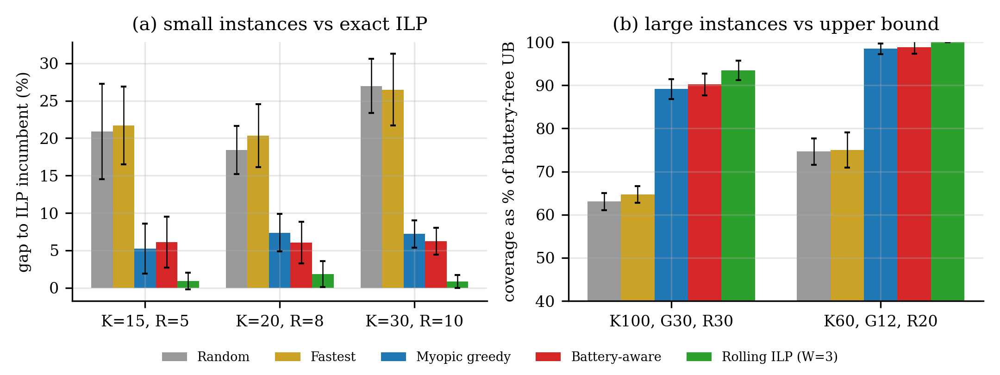
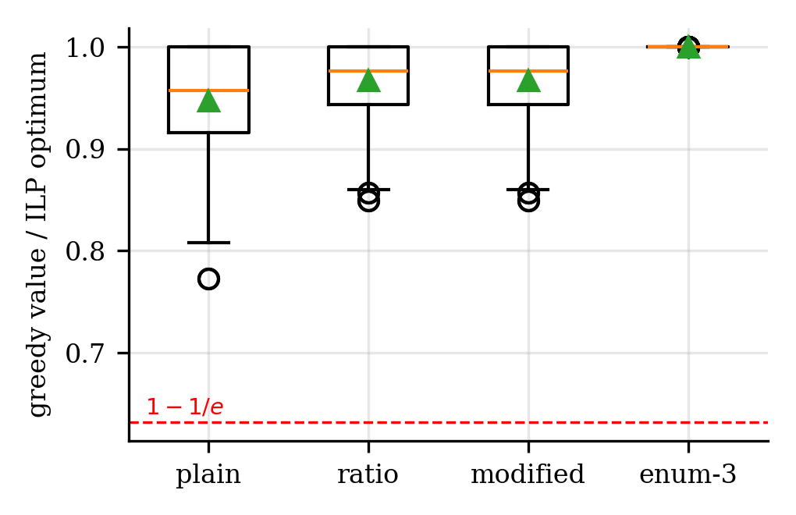
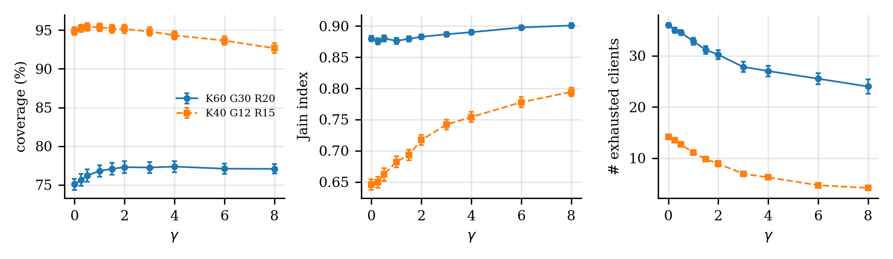
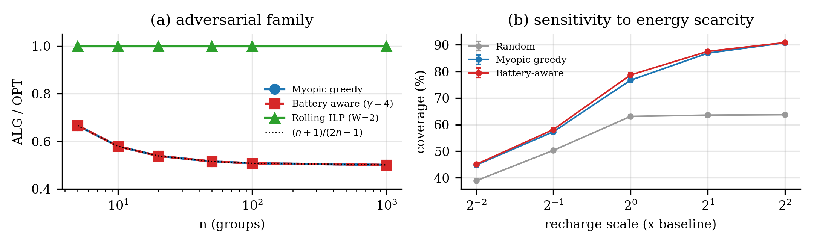
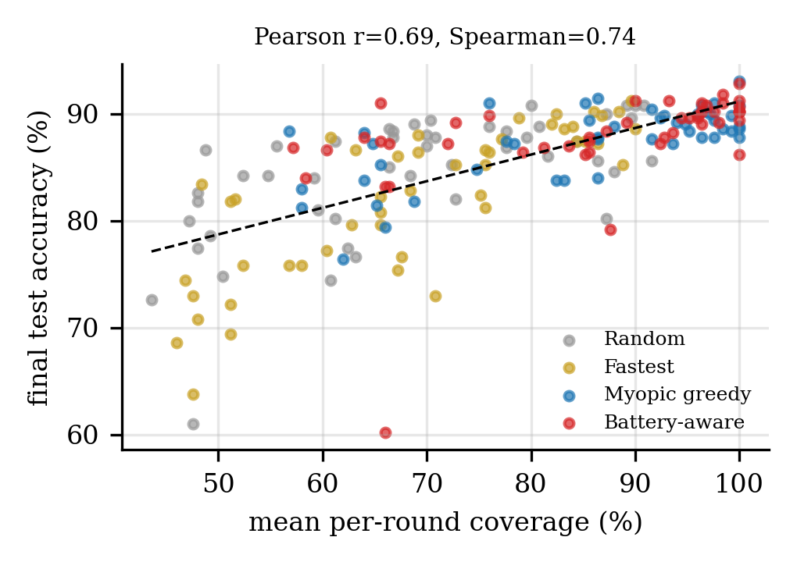

<h1 align="center">Energy-Aware Client Selection in Federated Learning</h1>

<p align="center">
  <i>Budgeted Maximum Coverage meets battery-constrained Federated Learning</i>
</p>

<p align="center">
  <a href="LICENSE"></a>
  
  
</p>

<p align="center">
  
</p>

---

## 👥 Authors & Contributors

This research project and codebase is jointly developed and maintained by:

- **Khagesh Ranjan** ([@khageshranjan23-pixel](https://github.com/khageshranjan23-pixel)) — Core algorithm enhancements, packaging, CLI tooling, test suites & CI/CD.
- **Sudipto Ghosh** ([@SudiptoGhosh1](https://github.com/SudiptoGhosh1)) — Mathematical formulation, ILP solver, policy implementations & research paper.
- **Shivanshu Tripathi** ([@shivanshtripathi21](https://github.com/shivanshtripathi21)) – Experimental evaluation, performance analysis, result visualization, literature review, and project documentation.

---

## ⚡ Quickstart & Installation

Install the package directly in editable mode:

```bash
git clone https://github.com/SudiptoGhosh1/energy-aware-fl-client-selection.git
cd energy-aware-fl-client-selection
pip install -e ".[dev]"
```

### 1. Interactive Tutorial Notebook
Explore the interactive Jupyter notebook at [`notebooks/quickstart_tutorial.ipynb`](notebooks/quickstart_tutorial.ipynb) to visualize battery dynamics, policy comparisons, and independent feasibility checking step-by-step.

### 2. Command-Line Interface (CLI)

Benchmark all policies side-by-side with formatted metrics:
```bash
flsel compare --clients 40 --groups 20 --rounds 10
```

Run a specific policy with custom parameters or JSON output:
```bash
flsel run --policy battery_aware --gamma 1.5 --json
```

### 3. Run the Test Suite

Verify all algorithmic constraints and unit tests:
```bash
python -m unittest discover tests -v
```

---

## 📌 Overview

This repository contains the **complete implementation, experimental suite, and figures** for a research project on energy-aware client selection in Federated Learning.

We study the **Energy-Aware Client Selection** problem in Federated Learning (FL): given a pool of heterogeneous edge devices (clients) that each hold subsets of training data (groups), a per-round energy budget, per-client battery dynamics, and a deadline constraint, **select which clients participate in each FL round** so as to maximise the total weighted data-group coverage across all rounds.

### Why it matters

Conventional FL schedulers (e.g., FedAvg's random selection) ignore battery state and energy costs, causing devices to be repeatedly over-selected until they are exhausted, reducing both coverage and fairness. Our formulation casts the problem as a **multi-round Budgeted Maximum Coverage ILP** with battery dynamics, and we derive, implement, and empirically compare five policies ranging from O(1) heuristics to receding-horizon exact solvers.

---

## 🔬 Problem Formulation

| Symbol | Meaning |
|--------|---------|
| K | number of clients |
| G | number of data groups |
| R | number of FL rounds |
| h[k,g] ∈ {0,1} | client k holds data group g |
| w[g] | weight / importance of group g |
| τ[k] | latency of client k (deadline constraint: τ[k] ≤ T_max) |
| e[k] | energy consumed by client k per participation |
| E[t] | round-t energy budget |
| m | maximum clients per round (cardinality constraint) |
| b[k,t] | battery level of client k at round t |
| ρ[k,t] | battery recharge of client k in round t |

**Objective (multi-round):**

```
maximise  Σ_t Σ_g  w[g] · z[g,t]
subject to
  z[g,t] ≤ Σ_{k: h[k,g]=1} x[k,t]          ∀g,t   (coverage)
  Σ_k x[k,t] ≤ m                              ∀t     (cardinality)
  Σ_k e[k]·x[k,t] ≤ E[t]                     ∀t     (energy budget)
  e[k]·x[k,t] ≤ b[k,t]                        ∀k,t   (battery feasibility)
  b[k,t+1] = min(bmax[k], b[k,t] - e[k]·x[k,t] + ρ[k,t])  ∀k,t   (dynamics)
  x[k,t] ∈ {0,1},  z[g,t] ∈ [0,1]
```

The single-round version is a **Budgeted Maximum Coverage** problem (NP-hard, submodular objective), admitting a (1 − 1/e) approximation.

---

## 🗂️ Repository Structure

```
.
├── flsel/                      # Core Python package
│   ├── __init__.py             # Package docstring & exports
│   ├── instance.py             # Synthetic instance generator
│   ├── checker.py              # Independent feasibility & objective checker
│   ├── greedy.py               # Single-round greedy algorithms (NWF, ratio, modified, partial-enum)
│   ├── ilp.py                  # Single-round & multi-round ILP/MILP (HiGHS via scipy)
│   ├── policies.py             # Multi-round policies, simulator, Jain fairness metric
│   └── fedavg.py               # FedAvg softmax regression on non-IID digits split
│
├── run_e0_reduction_check.py   # E0: NP-hardness reduction verification
├── run_e1_single_round.py      # E1: Single-round ILP validation & greedy ratios
├── run_e2_multiround_small.py  # E2: Multi-round ILP (exact) on small instances
├── run_e3_large.py             # E3: Large instances — policies vs upper bound
├── run_e4_gamma.py             # E4: Battery-aware γ sweep & energy scarcity
├── run_e5_adversarial.py       # E5: Adversarial family — worst-case ratio analysis
├── run_e6_fairness.py          # E6: ILP with fairness constraints (ρ-participation)
├── run_e7_fedavg.py            # E7: Coverage–accuracy correlation via FedAvg
│
├── make_figures.py             # Figure generation (300 dpi PNG)
├── make_figures_col.py         # Colour-variant figures
├── run_all.sh                  # Reproduce all results end-to-end (~25–30 min)
├── requirements.txt            # Python dependencies
│
├── results/                    # All experimental outputs (CSV, JSON, logs)
│   ├── numbers.json            # Master results summary
│   ├── tables.json             # LaTeX-ready table data
│   ├── e1_single_round.csv     # Greedy approximation ratios
│   ├── e2_small.csv            # Small instance ILP comparison
│   ├── e3_large.csv            # Large instance policy comparison
│   ├── e4_gamma.csv            # γ sensitivity sweep
│   ├── e4_scarcity.csv         # Energy scarcity sensitivity
│   ├── e5_adversarial.csv      # Adversarial worst-case ratios
│   ├── e6_fairness.csv         # Fairness constraint results
│   └── e7_fedavg.csv           # FedAvg accuracy vs coverage
│
├── figures/                    # Publication-quality figures
│   ├── fig_compare.png         # Main comparison: small ILP gap + large UB %
│   ├── fig_gamma.png           # γ sweep: coverage, Jain index, exhausted clients
│   ├── fig_adv_scarcity.png    # Adversarial family + energy scarcity
│   ├── fig_fl.png              # Coverage–accuracy scatter (FedAvg link)
│   └── fig_single.png          # Single-round greedy ratio distributions
│
└── research_paper.docx         # Research paper manuscript
```

---

## ⚙️ Setup & Installation

**Requirements:** Python 3.9+ with `scipy ≥ 1.9` (for HiGHS MILP solver — no external solver needed).

```bash
pip install numpy scipy>=1.9 pandas matplotlib scikit-learn
```

Or install from `requirements.txt`:

```bash
pip install -r requirements.txt
```

> **Note:** The ILP solver used is **HiGHS**, exposed through `scipy.optimize.milp`. No separate Gurobi/CPLEX license is required.

---

## 🚀 Reproducing All Results

```bash
sh run_all.sh
```

This runs all 8 experiments sequentially (single-core). Total wall time: **~25–30 minutes** (E2 exact ILP and E3 rolling ILP dominate). Results go to `results/`, figures to `figures/`.

To run individual experiments:

```bash
python3 run_e0_reduction_check.py   # < 1 second
python3 run_e1_single_round.py      # ~1 minute
python3 run_e2_multiround_small.py  # ~10 minutes (exact ILP)
python3 run_e4_gamma.py             # ~3 minutes
python3 run_e5_adversarial.py       # ~1 minute
python3 run_e6_fairness.py          # ~1 minute
python3 run_e7_fedavg.py            # ~2 minutes
python3 run_e3_large.py             # ~10 minutes (rolling ILP)
python3 make_figures.py             # < 10 seconds
python3 make_figures_col.py         # < 10 seconds
```

---

## 🧪 Experiments & Key Results

### E0 · NP-Hardness Reduction Check

Verifies that the instance generator correctly encodes the reduction from Vertex Cover to Budgeted Max Coverage. **632/632 instances** agree with the theoretical prediction.

---

### E1 · Single-Round Greedy Approximation Ratios

Validates the single-round ILP against brute force on tiny instances (K=14, G=10) — **0 mismatches in 60 trials**. Then benchmarks four greedy variants on 150 random instances:

| Algorithm | Mean ratio (knapsack) | Mean ratio (+cardinality m=5) | Time (ms) |
|-----------|----------------------|-------------------------------|-----------|
| Plain greedy (NWF) | 0.946 | 0.948 | 0.18 |
| Ratio greedy | 0.975 | 0.958 | 0.07 |
| Modified greedy | 0.975 | 0.958 | 0.11 |
| Partial enum-3 | **1.000** | **1.000** | 30–34 |

The LP bound is tight: LP/OPT = 1.019 on average, max 1.069 (n=150).

<p align="center">
  
</p>

---

### E2 · Multi-Round ILP on Small Instances

Compares all 5 policies against the exact multi-round ILP incumbent on instances with K ∈ {15, 20, 30}:

| Policy | Mean gap (K=15) | Mean gap (K=20) | Mean gap (K=30) |
|--------|----------------|----------------|----------------|
| Random | 20.9% | 18.4% | 27.0% |
| Fastest-first | 21.7% | 20.3% | 26.5% |
| Myopic greedy | 5.2% | 7.4% | 7.2% |
| Battery-aware (γ=1.5) | 6.1% | 6.0% | 6.2% |
| Rolling ILP (W=3) | **0.93%** | **1.82%** | **0.84%** |

Rolling ILP solves optimally or near-optimally across all sizes. Battery-aware and Myopic greedy are the best polynomial-time heuristics.

---

### E3 · Large Instances vs Battery-Free Upper Bound

Evaluated on two large configurations — K=100, G=30, R=30 and K=60, G=12, R=20 — using 15 random seeds each:

| Policy | K100 cov% (of UB) | K60 cov% (of UB) | K100 exhausted | K60 exhausted |
|--------|-------------------|------------------|----------------|---------------|
| Random | 63.0% | 74.6% | 36.7 | 11.7 |
| Fastest-first | 64.7% | 75.0% | 47.8 | 20.4 |
| Myopic greedy | 89.1% | 98.5% | 40.2 | 16.4 |
| **Battery-aware** | **90.2%** | **98.8%** | **25.3** | **7.7** |
| Rolling ILP (W=3) | 93.5% | **100.0%** | 38.6 | 4.0 |

Battery-aware greedy achieves **near-ILP quality** in milliseconds, with significantly fewer exhausted clients than myopic.

<p align="center">
  
</p>

---

### E4 · Battery-Aware γ Sweep & Energy Scarcity

The `γ` parameter in battery-aware greedy controls the trade-off between coverage and fairness. Results across γ ∈ {0, 0.25, 0.5, 1.0, 1.5, 2.0, 3.0, 4.0, 6.0, 8.0}:

- **Coverage** peaks around γ = 1.0–1.5 (K40: 95.4%, K60: 77.1%)
- **Jain fairness** index improves monotonically with γ (from 0.65 → 0.79 for K40)
- **Exhausted clients** decreases from ~14 → ~4 as γ increases (K40)
- Statistical significance: p = 0.034 (K40) and p = 1.7×10⁻⁶ (K60) for γ=1.5 vs γ=0

<p align="center">
  
</p>

---

### E5 · Adversarial Worst-Case Analysis

Constructs an adversarial instance family where greedy heuristics approach their theoretical worst-case ratio of ~0.5:

| n (groups) | Myopic ratio | Battery-aware ratio | Rolling ILP ratio |
|-----------|-------------|---------------------|-------------------|
| 5 | 0.667 | 0.667 | **1.000** |
| 10 | 0.579 | 0.579 | **1.000** |
| 100 | 0.508 | 0.508 | **1.000** |
| 1000 | 0.501 | 0.501 | **1.000** |

Rolling ILP is provably optimal on these instances. The adversarial ratio tracks (n+1)/(2n−1) → 0.5.

<p align="center">
  
</p>

---

### E6 · Fairness Constraints

Adds a minimum-participation constraint (ρ-fairness) to the multi-round ILP. Results on 8 instances:

| ρ (min participation fraction) | Feasible | Mean objective | Coverage loss |
|--------------------------------|----------|----------------|---------------|
| 0.0 | 8/8 | 399.1 | 0.00% |
| 0.1–0.2 | 8/8 | 399.1 | 0.00% |
| 0.3 | 8/8 | 398.6 | 0.13% |
| 0.4 | 2/8 | 398.5 | 5.11% |
| 0.5 | **0/8** | — | — |

Fairness can be enforced at minimal coverage cost up to ρ ≈ 0.3.

---

### E7 · FL Coverage–Accuracy Correlation

Validates that data-group coverage is a proxy for FL model accuracy. Runs FedAvg (softmax regression, numpy implementation) on a non-IID split of sklearn's 8×8 digits dataset across 4 policies × 48 seeds:

| Policy | Mean coverage % | Mean accuracy % |
|--------|----------------|----------------|
| Random | 68.5% | 84.3% |
| Fastest-first | 68.8% | 82.2% |
| Myopic greedy | 85.2% | 87.5% |
| **Battery-aware** | **86.0%** | **87.8%** |

**Pearson r = 0.694** (p < 10⁻²⁸), **Spearman ρ = 0.743** (p < 10⁻³⁴) — strong monotone relationship between coverage and accuracy.

<p align="center">
  
</p>

---

## 🏛️ Algorithms Implemented

### Single-Round (Greedy)

| Algorithm | File | Guarantee |
|-----------|------|-----------|
| Plain greedy (Nemhauser-Wolsey-Fisher) | `flsel/greedy.py` | (1−1/e) for unconstrained knapsack |
| Ratio greedy (Khuller-Moss-Naor) | `flsel/greedy.py` | ½(1−1/e) with knapsack |
| Modified greedy (+ best-single) | `flsel/greedy.py` | ½(1−1/e), tight on adversarial family |
| Partial enum-3 (Sviridenko) | `flsel/greedy.py` | (1−1/e) with knapsack + cardinality |

### Single-Round (Exact)

| Algorithm | File | Solver |
|-----------|------|--------|
| Single-round ILP | `flsel/ilp.py` | HiGHS via `scipy.optimize.milp` |
| LP relaxation (bound) | `flsel/ilp.py` | HiGHS continuous |

### Multi-Round Policies

| Policy | File | Complexity |
|--------|------|------------|
| Random | `flsel/policies.py` | O(K) per round |
| Fastest-first | `flsel/policies.py` | O(K log K) per round |
| Myopic greedy | `flsel/policies.py` | O(KG) per round |
| Battery-aware greedy (γ-parameterised) | `flsel/policies.py` | O(KG) per round |
| Rolling ILP (receding horizon, window W) | `flsel/policies.py` | MILP per round |

### Multi-Round (Exact)

| Algorithm | File | Notes |
|-----------|------|-------|
| Multi-round ILP | `flsel/ilp.py` | Full horizon; strengthen=True adds valid cuts |

---

## 📊 Code Quality

- **Independent checker** (`flsel/checker.py`): recomputes feasibility, battery trajectory, and objective from scratch given only the binary selection matrix X — used to assert correctness after every simulation.
- **Instance generator** (`flsel/instance.py`): fully parametric, reproducible (numpy default_rng seeding), supports arbitrary K, G, R, recharge rates, budget multipliers.
- **FedAvg** (`flsel/fedavg.py`): pure-numpy softmax regression with mini-batch SGD; non-IID data partition aligned with h[k,g] matrix.
- All experiments are reproducible with fixed seeds and logged to `results/`.

---

## 📄 Research Paper

| File | Description |
|------|-------------|
| `research_paper.docx` | Full research paper manuscript (problem formulation, algorithms, proofs, experiments, conclusions) |

---

## 📚 References

1. **Khuller, Moss, Naor** (1999). *The Budgeted Maximum Coverage Problem.* Information Processing Letters.
2. **Nemhauser, Wolsey, Fisher** (1978). *An analysis of approximations for maximizing submodular set functions.* Mathematical Programming.
3. **Sviridenko** (2004). *A note on maximizing a submodular set function subject to a knapsack constraint.* Operations Research Letters.
4. **McMahan et al.** (2017). *Communication-efficient learning of deep networks from decentralized data.* (FedAvg)
5. **Jain et al.** (1984). *A quantitative measure of fairness and discrimination for resource allocation.* (Jain's fairness index)

---

## 🔧 Module API Reference

### `flsel.instance`
```python
generate(K=40, G=20, R=10, seed=0, m=None, frac_eligible=0.7, ...) -> Instance
```
Generates a random instance. All parameters are documented in-source.

### `flsel.greedy`
```python
modified_greedy(h, w, cost, e, budget, m, cand) -> List[int]
partial_enum_greedy(h, w, cost, e, budget, m, cand, size=3) -> List[int]
coverage_value(h, w, sel) -> float
```

### `flsel.ilp`
```python
single_round_ilp(inst, avail, budget, m, time_limit=30.0, lp=False) -> (sel, value, info)
multi_round_ilp(inst, t0=0, W=None, b_init=None, fairness_rho=0.0, ...) -> dict
```

### `flsel.policies`
```python
simulate(inst, policy, seed=0, **kw) -> (X, metrics)
# policies: "random", "fastest", "myopic", "battery_aware", "rolling_ilp"
# metrics: total, cov_pct, full_rounds, exhausted_clients, jain, overflow, min_round_cov
```

### `flsel.checker`
```python
check(inst, X, fairness_rho=0.0) -> (feasible: bool, objective: float, messages: List[str])
```

### `flsel.fedavg`
```python
run_fedavg(inst, X_sel, data, seed=0) -> List[float]  # accuracy per round
```

---

## 📜 Citation

If you use this repository or research work, please cite:

```bibtex
@misc{ranjan_ghosh_2026_energy_fl,
  author = {Ranjan, Khagesh and Ghosh, Sudipto},
  title = {Energy-Aware Client Selection in Federated Learning as Multi-Round Budgeted Maximum Coverage},
  year = {2026},
  url = {https://github.com/SudiptoGhosh1/energy-aware-fl-client-selection}
}
```

---

<p align="center">
  <i>All results are fully reproducible. See <code>run_all.sh</code> to regenerate everything from scratch.</i>
</p>
